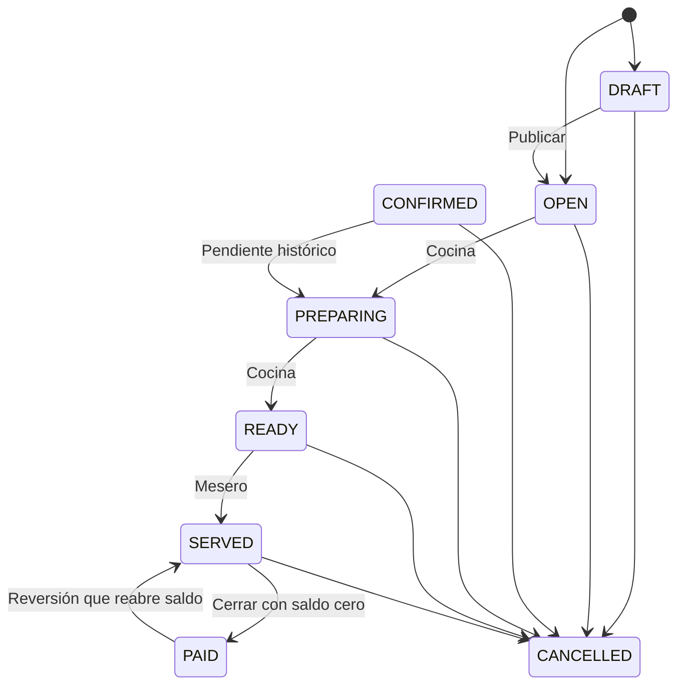

# Roles, órdenes y caja

## Arranque y migraciones

- Backend: Java 17+, Maven y PostgreSQL. Frontend: Node 22.18+ o 24.12+; `npm ci && npm run dev` desde `restaurant-ui`. Vue usa `VITE_API_BASE_URL` (por defecto `http://localhost:8088/api`). El backend permite `http://localhost:5173` por defecto; ajusta `RESTAURANT_CORS_ORIGINS` (lista separada por comas) si es necesario.
- Copia [.env.example](../.env.example) a `.env` y define tus credenciales de PostgreSQL, `RESTAURANT_JWT_SECRET` (Base64 de al menos 32 bytes; genera uno con `openssl rand -base64 32`) y, si no hay administrador activo, `RESTAURANT_BOOTSTRAP_ADMIN_PASSWORD`. La contraseña inicial debe tener al menos 12 caracteres y no exceder 72 bytes UTF-8. En Bash puedes exportar los valores con `set -a; . ./.env; set +a`. El email inicial es configurable; el usuario inicial se llama `admin`.
- Para una instalación **nueva**, crea una base vacía y arranca con `mvn spring-boot:run`; el comportamiento existente de Hibernate (`ddl-auto=update`) crea el esquema. Para una instalación **existente**, respalda y prueba primero en una copia, resuelve cualquier esquema histórico según [db/README.md](../db/README.md), y aplica los scripts en orden **antes** de arrancar:

```sh
psql -X --dbname=restaurant -v ON_ERROR_STOP=1 \
  -f db/001-rbac.up.sql -f db/002-order-history.up.sql \
  -f db/003-payments.up.sql -f db/004-menu-active.up.sql
```

- El arranque siembra los roles y sus permisos iniciales sin restablecer los otorgamientos editados. Las asignaciones y cuentas existentes no cambian. El administrador de arranque se crea con BCrypt si se proporciona la contraseña y no hay ya uno activo. Quita esa variable después del primer arranque. Los datos de demostración están desactivados; usa `RESTAURANT_SAMPLE_SEED=true` y `RESTAURANT_SAMPLE_PASSWORD` **solo** en desarrollo.
- Rollback: detén la versión nueva, respalda/exporta permisos, historial y metadatos de pagos y revierte los `.down.sql` en orden **004 → 003 → 002 → 001**. Los scripts no borran registros de tablas originales, pero sí eliminan las columnas/tablas añadidas; concilia primero las reversiones y los pagos pendientes, porque la versión anterior no los distingue. Si ya hubo operación real, suele ser más seguro restaurar el respaldo y conciliar que usar una reversión ciega.

## Datos y reglas

- `Role.permissions` se persiste en `role_permissions`. Cada usuario conserva una FK a su rol. El JWT identifica el ID del usuario; actividad del usuario, actividad del rol y permisos se verifican en cada petición. El rol `admin` es inmutable desde la API y no se permite quitar al último administrador activo.
- `order_status_history` registra orden, actor, fecha, origen, destino y motivo. Una creación tiene origen nulo. No se inventa historial para órdenes anteriores. Meseros editan y sirven sus propias órdenes; `orders:assign` permite asignar/editar órdenes ajenas. Cocina y caja consultan las órdenes necesarias para operar.
- `Payment` guarda monto principal, método, estado, propina, efectivo recibido, cambio, referencia, operador y fecha. Una reversión conserva estado anterior, motivo, actor, fecha y referencia de reversión. No se guardan datos completos de tarjeta y no se piden en el formulario.
- Los precios se toman del catálogo y se fijan en la partida. Para órdenes nuevas, `RESTAURANT_ORDER_TAX_RATE` se fija al crear la orden (fracción de 0 a 1, por ejemplo `0.16`; por defecto 0). El backend redondea el impuesto a centavos. Las órdenes históricas no reciben impuestos retroactivos. Los pagos históricos se conservan como completados con propina cero y operador desconocido. Valida los saldos de órdenes históricas importadas antes de operar.
- El saldo resta solo principal completado; la propina queda separada. Los pendientes reservan importe para impedir sobrecobros. Efectivo recibido debe cubrir principal más propina. La orden, cobros, cambios de partidas, cierre y reembolsos comparten un bloqueo transaccional por orden. Un reintento con la misma clave y los mismos datos devuelve el registro existente.
- Tarjeta y transferencia son **simuladas**; pueden aprobarse, fallar o quedar pendientes. Un pendiente simulado se anula, no se liquida automáticamente. Los reembolsos son de un pago completo, incluida su propina. El ticket se imprime desde el navegador, marca los pagos simulados y no es una factura fiscal.



Para mandar una orden a cocina necesita partidas. La cancelación requiere motivo y que no haya pagos completados ni pendientes sin revertir. `PAID` y `CANCELLED` bloquean editar o quitar/agregar partidas; un reembolso autorizado que reabre el saldo es la única salida de `PAID`.

## Permisos por defecto

| Permiso | admin | gerente | mesero | cocina | cajero |
| --- | :---: | :---: | :---: | :---: | :---: |
| `orders:view`, `items:view`, `floor:view`, `orders:update_status` | ✓ | ✓ | ✓ | ✓ | ✓ |
| `orders:create`, `orders:edit`, `orders:serve`, `orders:cancel` | ✓ | ✓ | ✓ | — | — |
| `orders:assign`, `items:manage`, `floor:manage`, `reports:view` | ✓ | ✓ | — | — | — |
| `orders:prepare` | ✓ | ✓ | — | ✓ | — |
| `orders:complete`, `payments:view`, `payments:create` | ✓ | ✓ | — | — | ✓ |
| `payments:refund` | ✓ | ✓ | — | — | — |
| `users:manage`, `roles:manage` | ✓ | — | — | — | — |

`manager`, `waiter` y `cocker` conservan sus nombres y reciben, respectivamente, el acceso inicial de gerente, mesero y cocina. `cleaner` no recibe privilegios iniciales. Los roles nuevos parten de los permisos seleccionados por el administrador; solo `admin` gestiona roles aunque otro rol tuviera `roles:manage`. `reports:view` queda reservado para la futura API de reportes.

## Contrato HTTP

Rutas relativas a `/api`. Los listados que admiten paginación toman `page` (desde 0) y `size` (1–100). Sus rutas `/count` aceptan los mismos filtros, sin limitar el total.

| Método | Ruta | Permiso |
| --- | --- | --- |
| POST | `/auth/login` | Público |
| GET | `/me` | Sesión activa |
| POST | `/auth/register` | Solo admin (registro histórico) |
| GET, POST | `/user/users` | `users:manage`; GET admite búsqueda, filtros y páginas |
| GET | `/user/users/count` | `users:manage` |
| PUT | `/user/users/{id}` | `users:manage`; rol y activación en el cuerpo |
| GET | `/role/roles`, `/role/roles/count` | `users:manage` o `roles:manage` |
| GET | `/role/roles/permissions` | Admin con `roles:manage` |
| POST, PUT | `/role/roles`, `/role/roles/{id}` respectivamente | Admin con `roles:manage` |
| GET | `/order/orders`, `/order/orders/count`, `/order/orders/{id}/history` | `orders:view` |
| POST | `/order/orders` | `orders:create` |
| PUT | `/order/orders/{id}` | `orders:edit`; publicar también requiere `orders:update_status` |
| POST | `/order/orders/{id}/status` | `orders:update_status` y el permiso de destino: `orders:edit`, `orders:prepare` o `orders:serve` |
| POST | `/order/orders/{id}/cancel`, `/order/orders/{id}/complete` | `orders:cancel` / `orders:complete`, respectivamente |
| GET | `/order-item/order-items`, `/order-item/order-items/count` | `orders:view` |
| POST, DELETE | `/order-item/order-items`, `/order-item/order-items/{id}` respectivamente | `orders:edit` |
| GET | `/order/orders/{id}/balance`, `/payment/payments`, `/payment/payments/count` | `payments:view` |
| POST | `/payment/payments` | `payments:create`; encabezado `Idempotency-Key` obligatorio |
| POST | `/payment/payments/{id}/refund` | `payments:refund`; cuerpo `{"reason":"…"}` |
| GET | Catálogos de menú (`/item/items`, `/category/categories`, alergias, presentaciones, atributos, sus `/count`) | `items:view`; `includeInactive=true` además requiere `items:manage` |
| POST, PUT | Alta de productos/catálogos, edición de producto en `/item/items/{id}` | `items:manage` |
| GET / escritura | Pisos, mesas, elementos y tipos de elementos | `floor:view` / `floor:manage`, respectivamente |

Compatibilidad a tener en cuenta:

- Las rutas previas siguen disponibles en general, pero ahora exigen autenticación y permisos. El registro dejó de ser público. La actualización requiere iniciar sesión nuevamente; rota las credenciales que antes estaban versionadas y cambia las contraseñas de cuentas de ejemplo que hayan sido sembradas con claves previas.
- Al crear, el estado solo puede ser `DRAFT` (por defecto) u `OPEN` (pendiente). El cliente no fija total ni precio de partidas. El antiguo envío directo a `READY` se reemplaza por publicación a `OPEN`; para cancelar, cerrar o avanzar se usan las acciones específicas. Las respuestas de órdenes omiten los detalles de pagos (arreglo vacío) sin `payments:view`.
- Cobrar exige orden servida, clave de idempotencia y, para efectivo, `cashReceived`. Consulta el saldo antes de cobrar, y no interpretes un pago simulado como un movimiento de fondos. Respuestas 401/403 indican sesión/permisos, 404 referencias inexistentes, 409 conflictos de estado o saldo y 422 reglas de entrada de negocio. Se preserva 400 para JSON ilegible y errores básicos de DTO. Las respuestas de error ya no publican trazas internas.

## Verificación y pendientes

`mvn verify` ejecuta las pruebas de permisos HTTP, estados, historial, precios, saldo, cobros parciales, idempotencia y reembolsos. En `restaurant-ui`, ejecuta `npm run lint`, `npm run test:unit -- --run` y `npm run build`. El build usa tipos OpenAPI versionados; para actualizarlos contra la API local, ejecuta `npm run gen:api`.

Siguientes pasos: proveedor real con webhooks verificados, idempotencia y conciliación; informes de caja; integración con impresora térmica o facturación, si se requiere. Confirmar la política de impuestos con quien lleva la contabilidad antes de habilitarla.
